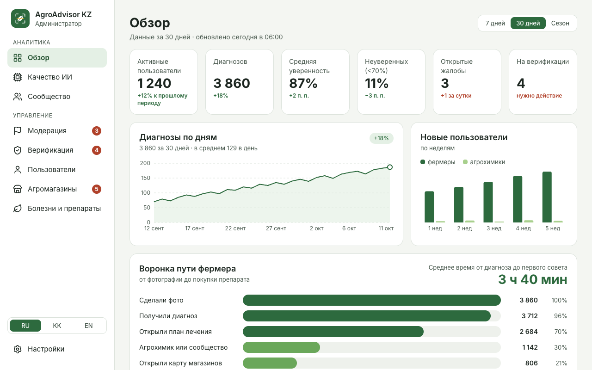
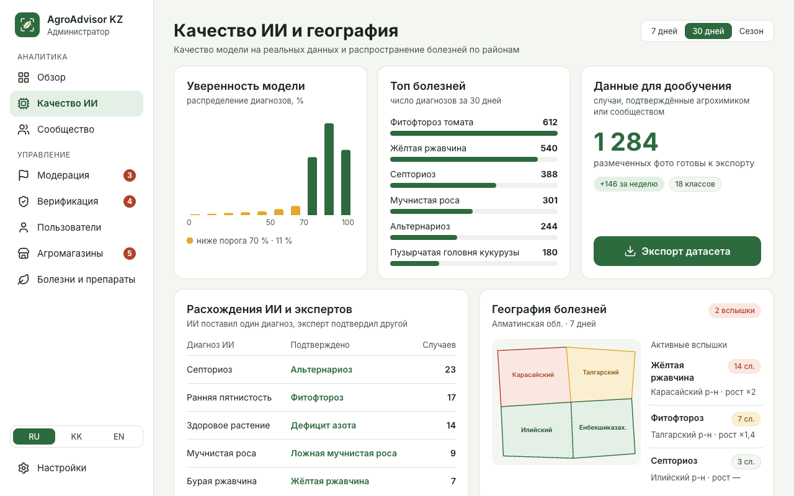
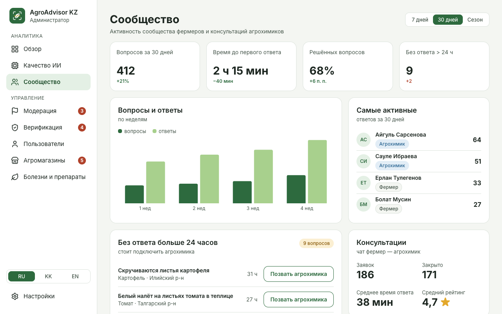
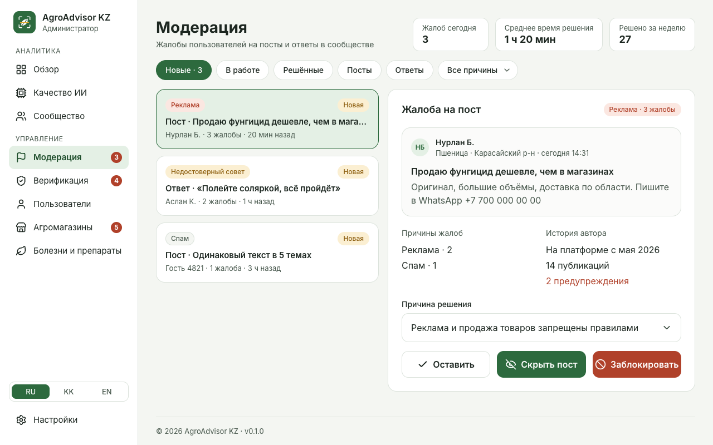
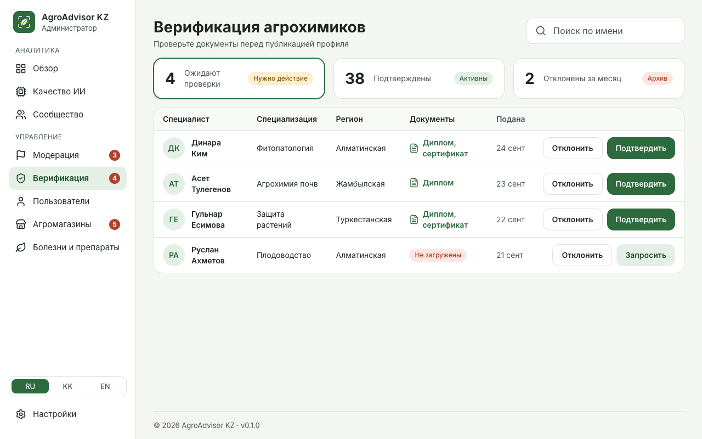
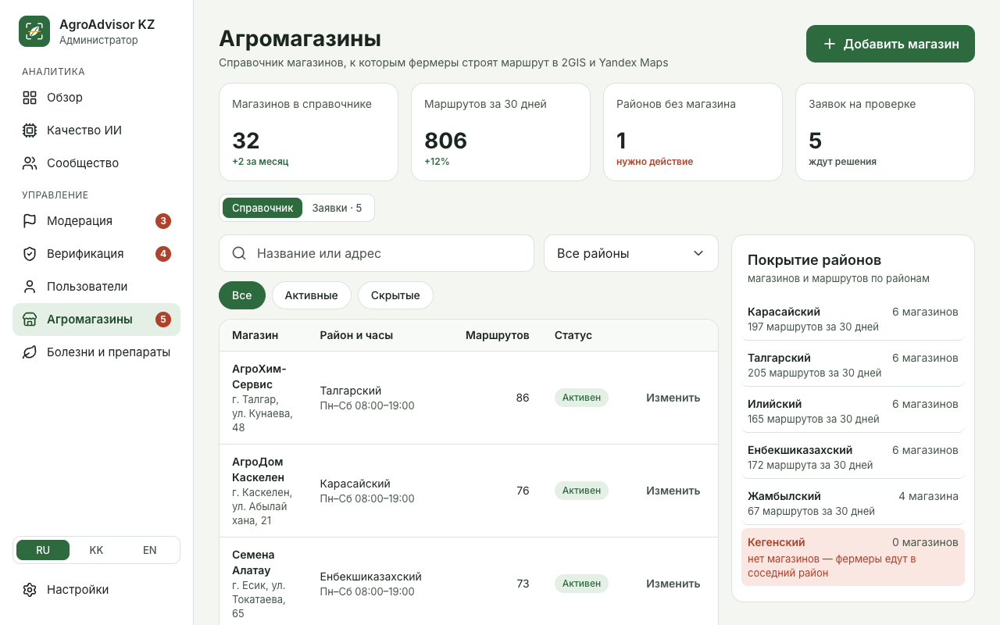
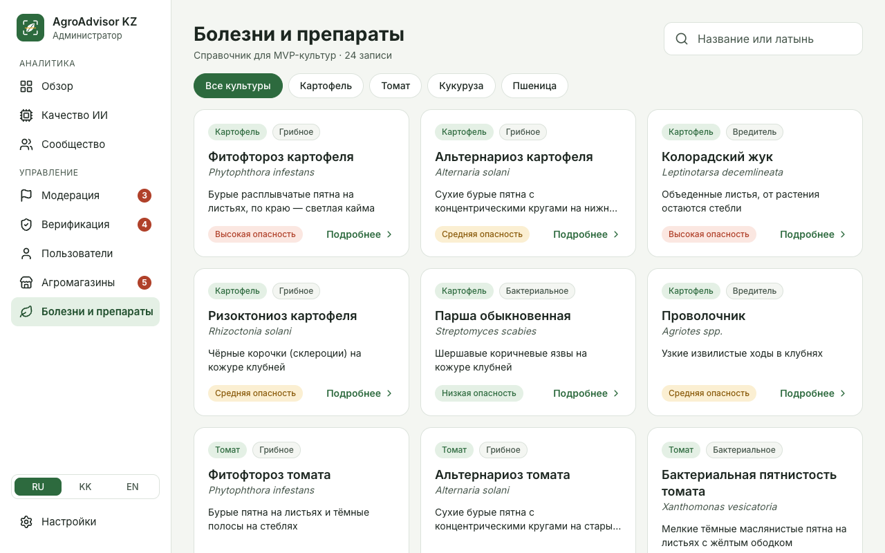
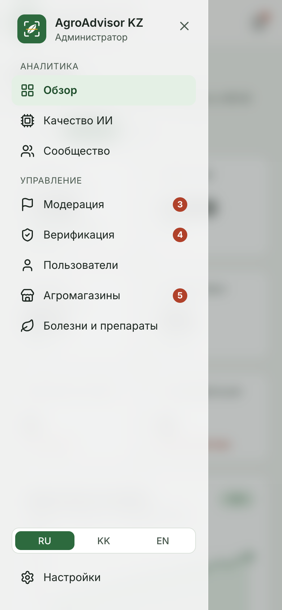

# AgroAdvisor KZ — Admin Web

Web admin panel of AgroAdvisor KZ. Administrators moderate the farmer community, verify agrochemists, keep the disease and shop directories up to date and follow how the AI diagnosis model performs.

The app runs on mock data with a simulated network delay, so it works without the backend. All data goes through one service contract, which will later be backed by the REST API.



## Features

| Section      | What the admin can do                                                                                                               |
| ------------ | ----------------------------------------------------------------------------------------------------------------------------------- |
| Overview     | KPIs, diagnoses by day, new users, farmer journey funnel; 7 days / 30 days / season                                                 |
| AI quality   | Model confidence histogram, top diseases, AI vs expert mismatches, disease outbreaks by district, CSV export of the labeled dataset |
| Community    | Questions and answers, most active members, questions without an answer for 24+ hours with an agrochemist invite, consultations     |
| Moderation   | Complaints by status, type and reason; keep, hide or block with confirmation                                                        |
| Verification | Agrochemist applications with diplomas and certificates; approve, reject with a reason, request documents                           |
| Users        | Farmers and agrochemists with role filter and search                                                                                |
| Agro shops   | Directory with coverage by district, add / edit / hide shops, farmers' requests (new shop, wrong data, closed shop)                 |
| Diseases     | Catalog for potato, tomato, corn and wheat; symptoms, conditions, chemical and biological treatment, prevention                     |
| Settings     | Profile, interface language, default period, AI confidence threshold, notifications                                                 |

Long lists are paginated, with the page kept in the URL. The layout adapts down to 390 px: below 1024 px the sidebar turns into a top bar with a slide-in menu.

## Screenshots

|                                                            |                                                                |
| ---------------------------------------------------------- | -------------------------------------------------------------- |
|  |        |
|  |  |
|       |          |



## Tech stack

- React 18, TypeScript, Vite
- React Router 6 (pages are lazy-loaded)
- Tailwind CSS 4 with design tokens from the Figma design system
- Recharts, lucide-react
- ESLint, Prettier

## Requirements

- Node.js 20.19+ or 22.13+ (required by Vite 8 and ESLint 10)
- npm 10+

## Getting started

```bash
cd apps/admin-web
npm ci
npm run dev
```

The app opens at http://localhost:5173.

## Scripts

| Command                | Description                                      |
| ---------------------- | ------------------------------------------------ |
| `npm run dev`          | Start the dev server                             |
| `npm run build`        | Type-check and build for production into `dist/` |
| `npm run preview`      | Serve the production build locally               |
| `npm run lint`         | Run ESLint                                       |
| `npm run format`       | Format the code with Prettier                    |
| `npm run format:check` | Check formatting without changing files          |

## Project structure

```
src/
├── app/            # Entry point, root component, router, lazy-loaded pages
├── layouts/        # Main layout, sidebar, mobile menu, footer
├── components/ui/  # Reusable UI: Button, Card, Badge, DataTable, Modal, Pagination, …
├── features/       # One folder per section: dashboard, ai-quality, community,
│                   # moderation, agrochemists, users, shops, diseases, settings
├── pages/          # Shared pages: not found, section placeholder
├── services/       # api.ts — data contract; mockApi.ts — mock implementation
├── mocks/          # Mock data
├── shared/         # Types, constants, hooks, settings, utils
└── styles/         # Tailwind setup and design tokens
```

## Data layer

Pages never import mock data directly. They call `api` from `src/services/api.ts`, which implements the `AdminApi` interface. Today it points to `mockApi`: responses come after a 400 ms delay, and actions such as approving an agrochemist or hiding a shop change the data until the page is reloaded.

To connect the backend, add an HTTP implementation of `AdminApi` and export it as `api`; pages stay the same.

Settings are stored in the browser (`localStorage`) for now.

## Design and accessibility

- Colors, typography and spacing follow the AgroAdvisor design system; tokens live in `src/styles/index.css`.
- Glass surfaces (backdrop blur) are used for the mobile top bar, the slide-in menu and modals.
- Text contrast is at least 4.5:1, touch targets are at least 48 px, statuses are labeled with words and icons, and all controls work from the keyboard.

## Related docs

- [System architecture](../../docs/architecture.md)
- [Git workflow](../../docs/git-workflow.md)
- [Brand kit](../../docs/brand/README.md)
