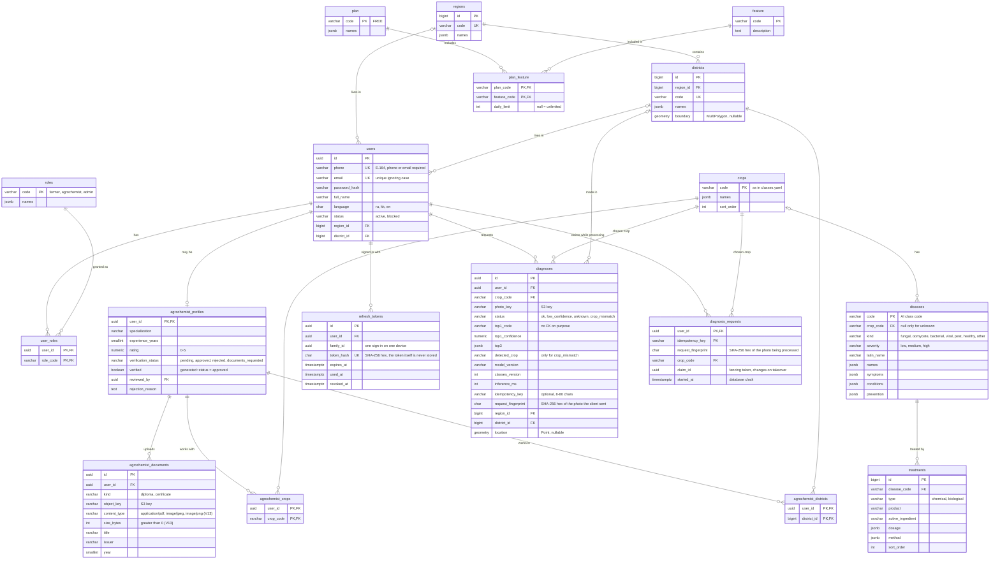
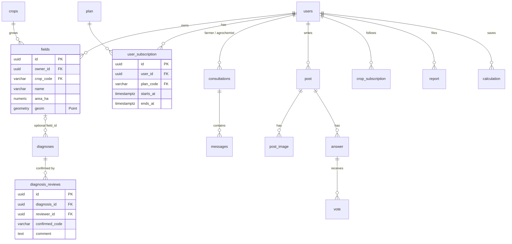

# Database ER diagram

PostgreSQL 16 + PostGIS. The schema is owned by Flyway migrations in [`services/backend/src/main/resources/db/migration`](../../services/backend/src/main/resources/db/migration); this page describes migrations `V1`–`V15`.

Conventions:

- Translated texts are `jsonb` objects `{"ru": …, "kk": …, "en": …}`; for names all three languages are required by a check constraint.
- Users, diagnoses and documents use `uuid` keys (they appear in URLs and the API); reference data uses readable codes (`tomato`, `tomato__late_blight`, `farmer`, `FREE`).
- Coordinates are `geometry(…, 4326)` with GiST indexes.
- Photos and documents are stored in S3 storage (SeaweedFS); tables keep only object keys.

## Current schema

Seed data in migrations: roles `farmer`, `agrochemist`, `admin`; plan `FREE` with features `diagnosis`, `community`, `consultations`, `disease_map`, `weather`, `calculator`, `shops`, `catalog` — all unlimited. `V8`–`V10` add the crops (tomato, potato, corn, wheat), the `unknown` class, the diseases of the model's classes and their treatments, with draft texts: the Kazakh texts are not checked by a native speaker and treatments must be confirmed by an agrochemist. Regions and districts are still empty.

### Notes

- **`diagnoses.top1_code` has no foreign key.** A new model may return a class that is not in the catalog yet; the diagnosis is saved and shown as "description coming soon" (rule 5 in [`docs/ai/classes.md`](../ai/classes.md)).
- **`diagnoses.region_id`** is copied from `users.region_id` when the diagnosis is saved and never updated: it records where the farmer was registered at that time, for the outbreak map and the model-quality figures. Null when the user picked no region. `district_id` and `location` are not filled yet.
- **`agrochemist_profiles.verified`** is computed from `verification_status`, so the two never disagree. Farmers see only verified agrochemists.
- **`agrochemist_profiles.reviewed_by`** references `users(id)` with the default `NO ACTION` on purpose: an admin who reviewed someone is never deleted (audit trail); an admin is blocked (`users.status`) instead.
- **Documents (`V13`).** `agrochemist_documents` records what the stored object is: `content_type` (recognised from the file's first bytes at upload, never from the client's header) and `size_bytes`, so the admin can be given the file with the right type. The migration refuses to apply if the table already has rows (nothing wrote to it before the verification API).
- **Refresh tokens (`V6`).** Only the SHA-256 of the opaque token is stored. Tokens of one sign-in on one device form a family: each refresh marks the old token as used and issues a new one; presenting a used token revokes the family.
- **Idempotency (`V11`, `V12`).** `POST /api/diagnoses` may carry an `Idempotency-Key`. A partial unique index on `(user_id, idempotency_key)` (rows without a key do not collide) makes a repeat return the first diagnosis. A check constraint requires `request_fingerprint` whenever there is a key, so a repeat can tell the same photo from another one.
- **Claims (`V14`).** `diagnosis_requests` has a row only while a request with an `Idempotency-Key` is being processed, so a second request with the same key does not call the model again. The primary key `(user_id, idempotency_key)` is the claim (`INSERT … ON CONFLICT DO NOTHING`); no lock is held while the model runs. `claim_id` is a fencing token: a claim older than `app.diagnosis.claim-timeout` is taken over by writing a new `claim_id` (only for the same `request_fingerprint` and crop), and a request releases or finishes only the claim whose `claim_id` it holds. `started_at` is the database clock. The row is deleted in the same transaction that inserts the diagnosis; abandoned rows are removed after an hour. The result stays protected by the unique index of `V11`. Every attempt stores its photo under a new random name, so no attempt overwrites the object of another.
- **Photo key index (`V15`).** A plain (not unique) index `diagnoses_photo_key_idx` on `diagnoses.photo_key`. The nightly cleanup of orphaned photo objects asks, for batches of keys, which of them a diagnosis still points to (issue #69, [ADR 0002](../adr/0002-orphan-photo-cleanup.md)). Any new table that refers to an object under `diagnoses/` must be added to that lookup, or the cleanup would delete its photo.
- **`diseases.kind` (`V7`)** has `oomycete` for late blight (*Phytophthora*), which is neither a fungus nor a bacterium: the treatment and the advice differ.
- **Feature access.** Code checks whether the user's plan includes a feature instead of checking roles, so paid plans can be added later as data. Today everyone is on `FREE` and nothing is limited; the per-minute diagnosis rate limit lives in Redis, not in the database.

## Planned tables

Added by later migrations when the corresponding features are built; existing migrations are never edited.

Also planned: `consultations`, `messages`, `agro_shops`, community tables (`post`, `post_image`, `answer`, `vote`, `crop_subscription`, `report`, plus `users.reputation`), `calculation`, `disease_alert`.
