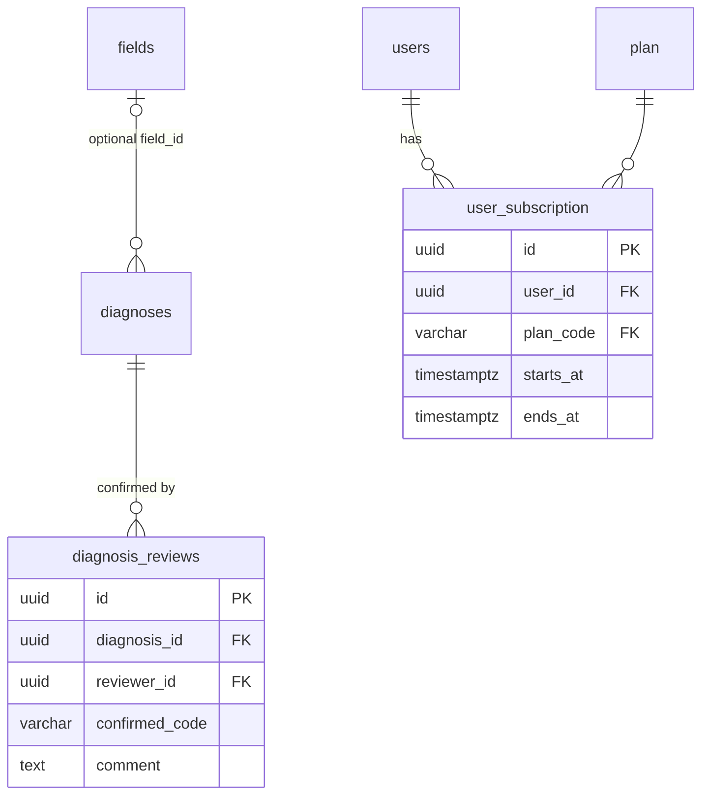

# Database ER diagram

PostgreSQL 16 + PostGIS. The schema is owned by Flyway migrations in [`services/backend/src/main/resources/db/migration`](../../services/backend/src/main/resources/db/migration); this page describes migrations `V1`–`V25`.

Conventions:

- Translated texts are `jsonb` objects `{"ru": …, "kk": …, "en": …}`; for names all three languages are required by a check constraint.
- Users, diagnoses and documents use `uuid` keys (they appear in URLs and the API); reference data uses readable codes (`tomato`, `tomato__late_blight`, `farmer`, `FREE`).
- Coordinates are `geometry(…, 4326)` with GiST indexes.
- Photos and documents are stored in S3 storage (SeaweedFS); tables keep only object keys.

## Current schema

```mermaid
erDiagram
    regions ||--o{ districts : contains
    regions |o--o{ users : "lives in"
    districts |o--o{ users : "lives in"
    users ||--o{ user_roles : has
    roles ||--o{ user_roles : "granted as"
    users ||--o| agrochemist_profiles : "may be"
    agrochemist_profiles ||--o{ agrochemist_documents : uploads
    agrochemist_profiles ||--o{ agrochemist_crops : "works with"
    agrochemist_profiles ||--o{ agrochemist_districts : "works in"
    crops ||--o{ agrochemist_crops : ""
    districts ||--o{ agrochemist_districts : ""
    crops |o--o{ diseases : has
    diseases ||--o{ treatments : "treated by"
    plan ||--o{ plan_feature : includes
    feature ||--o{ plan_feature : "included in"
    users ||--o{ refresh_tokens : "signed in with"
    users ||--o{ diagnoses : requests
    diagnoses ||--o{ diagnosis_reviews : "checked by"
    users ||--o{ diagnosis_reviews : "gives a verdict"
    users ||--o{ diagnosis_requests : "claims while processing"
    crops ||--o{ diagnosis_requests : "chosen crop"
    crops ||--o{ diagnoses : "chosen crop"
    districts |o--o{ diagnoses : "made in"
    users ||--o{ consultations : "asks as farmer"
    users ||--o{ consultations : "advises as agrochemist"
    diagnoses |o--o{ consultations : "attached to"
    consultations ||--o{ consultation_messages : contains
    users ||--o{ consultation_messages : sends
    users ||--o{ push_tokens : "registers devices"
    users ||--o{ notifications : receives
    consultations |o--o{ notifications : "refers to"
    consultation_messages |o--o{ notifications : "refers to"
    diagnoses |o--o{ notifications : "refers to"
    users ||--o{ fields : owns
    crops ||--o{ fields : grows
    users ||--o{ calculations : saves
    crops ||--o{ calculations : "calculated for"
    regions |o--o{ fields : "set by the server"
    districts |o--o{ fields : "set by the server"
    regions |o--o{ shops : "set by an admin"
    districts |o--o{ shops : "set by an admin"
    users ||--o{ shop_requests : writes
    shops |o--o{ shop_requests : "is about"
    users ||--o{ community_questions : asks
    crops ||--o{ community_questions : "about"
    regions ||--o{ community_questions : "copied from the profile"
    districts |o--o{ community_questions : "copied from the profile"
    diagnoses |o--o{ community_questions : "attached to"
    users |o--o{ community_questions : "hides"
    community_questions ||--o{ community_question_photos : has
    community_questions ||--o{ community_answers : has
    users ||--o{ community_answers : writes
    users |o--o{ community_answers : "hides"
    community_answers |o--o| community_questions : "is the best answer of"
    community_answers ||--o{ community_votes : receives
    users ||--o{ community_votes : casts
    users ||--o{ community_crop_subscriptions : follows
    crops ||--o{ community_crop_subscriptions : ""
    community_questions ||--o{ community_complaints : "is the target of"
    community_answers |o--o{ community_complaints : "is the target of"
    users |o--o{ community_complaints : "resolves"
    community_complaints ||--o{ community_reports : "collects"
    users ||--o{ community_reports : files

    regions {
        bigint id PK
        varchar code UK
        jsonb names
    }
    districts {
        bigint id PK
        bigint region_id FK
        varchar code UK
        jsonb names
        geometry boundary "MultiPolygon, nullable"
    }
    users {
        uuid id PK
        varchar phone UK "E.164, phone or email required"
        varchar email UK "unique ignoring case"
        varchar password_hash
        varchar full_name
        char language "ru, kk, en"
        varchar status "active, blocked"
        bigint region_id FK
        bigint district_id FK
    }
    roles {
        varchar code PK "farmer, agrochemist, admin"
        jsonb names
    }
    user_roles {
        uuid user_id PK, FK
        varchar role_code PK, FK
    }
    refresh_tokens {
        uuid id PK
        uuid user_id FK
        uuid family_id "one sign-in on one device"
        char token_hash UK "SHA-256 hex, the token itself is never stored"
        timestamptz expires_at
        timestamptz used_at
        timestamptz revoked_at
    }
    agrochemist_profiles {
        uuid user_id PK, FK
        varchar specialization
        smallint experience_years
        numeric rating "0-5"
        varchar verification_status "pending, approved, rejected, documents_requested"
        boolean verified "generated: status = approved"
        uuid reviewed_by FK
        text rejection_reason
    }
    agrochemist_documents {
        uuid id PK
        uuid user_id FK
        varchar kind "diploma, certificate"
        varchar object_key "S3 key"
        varchar content_type "application/pdf, image/jpeg, image/png (V13)"
        int size_bytes "greater than 0 (V13)"
        varchar title
        varchar issuer
        smallint year
    }
    agrochemist_crops {
        uuid user_id PK, FK
        varchar crop_code PK, FK
    }
    agrochemist_districts {
        uuid user_id PK, FK
        bigint district_id PK, FK
    }
    crops {
        varchar code PK "as in classes.yaml"
        jsonb names
        int sort_order
    }
    diseases {
        varchar code PK "AI class code"
        varchar crop_code FK "null only for unknown"
        varchar kind "fungal, oomycete, bacterial, viral, pest, healthy, other"
        varchar severity "low, medium, high"
        varchar latin_name
        jsonb names
        jsonb symptoms
        jsonb conditions
        jsonb prevention
    }
    treatments {
        bigint id PK
        varchar disease_code FK
        varchar type "chemical, biological"
        varchar product
        varchar active_ingredient
        jsonb dosage
        jsonb method
        int sort_order
    }
    plan {
        varchar code PK "FREE"
        jsonb names
    }
    feature {
        varchar code PK
        text description
    }
    plan_feature {
        varchar plan_code PK, FK
        varchar feature_code PK, FK
        int daily_limit "null = unlimited"
    }
    diagnoses {
        uuid id PK
        uuid user_id FK
        varchar crop_code FK
        varchar photo_key "S3 key"
        varchar status "ok, low_confidence, unknown, crop_mismatch"
        varchar top1_code "no FK on purpose"
        numeric top1_confidence
        jsonb top3
        varchar detected_crop "only for crop_mismatch"
        varchar model_version
        int classes_version
        int inference_ms
        varchar idempotency_key "optional, 8-80 chars"
        char request_fingerprint "SHA-256 hex of the photo the client sent"
        bigint region_id FK
        bigint district_id FK
        geometry location "Point, nullable"
    }

    fields {
        uuid id PK
        uuid owner_id FK
        varchar name "up to 80, trimmed, not empty"
        varchar crop_code FK
        numeric area_ha "above 0, up to 10000"
        varchar area_unit "ha or sotka, what the farmer typed"
        numeric latitude "with longitude, or both empty"
        numeric longitude
        geometry location "Point, computed from latitude and longitude"
        bigint region_id FK "set by the server"
        bigint district_id FK "set by the server, nullable"
        timestamptz created_at
        timestamptz updated_at
    }

    calculations {
        uuid id PK
        uuid owner_id FK
        varchar crop_code FK
        smallint season "2000 to 2100"
        numeric area_ha "above 0, up to 10000"
        varchar area_unit "ha or sotka, what the farmer typed"
        numeric yield_c_ha "centners per hectare"
        numeric price_t "price per tonne"
        jsonb costs "name to amount, made by the app"
        jsonb results "name to number, calculated by the app"
        timestamptz created_at
    }

    shops {
        uuid id PK
        varchar name
        varchar address
        varchar phone
        varchar hours
        text_array categories "free codes"
        numeric latitude
        numeric longitude
        geometry location "generated, GiST index"
        bigint region_id FK
        bigint district_id FK
        varchar status "active or hidden"
        timestamptz created_at
        timestamptz updated_at
    }

    shop_requests {
        uuid id PK
        uuid author_id FK
        varchar type "new_shop, wrong_info or closed"
        uuid shop_id FK "null for new_shop"
        varchar comment
        numeric latitude "only for new_shop"
        numeric longitude "only for new_shop"
        varchar status "new, done or rejected"
        timestamptz created_at
    }

    community_questions {
        uuid id PK
        uuid author_id FK
        varchar crop_code FK
        bigint region_id FK "copied from the author profile"
        bigint district_id FK "nullable"
        uuid diagnosis_id FK "nullable, ON DELETE SET NULL"
        varchar title "3 to 120, trimmed"
        varchar body "up to 2000, trimmed"
        uuid accepted_answer_id FK "the best answer, composite FK with id"
        varchar status "generated: open or solved"
        timestamptz hidden_at "set with hidden_by"
        uuid hidden_by FK "NO ACTION"
        timestamptz created_at
    }

    community_question_photos {
        uuid id PK
        uuid question_id FK
        varchar photo_key "S3 key under community/"
        varchar content_type "image/jpeg, image/png"
        int size_bytes "greater than 0"
        smallint position "0 to 2, unique with question_id"
    }

    community_answers {
        uuid id PK
        uuid question_id FK "unique with id"
        uuid author_id FK
        varchar body "up to 2000, trimmed"
        timestamptz hidden_at "set with hidden_by"
        uuid hidden_by FK "NO ACTION"
        timestamptz created_at
    }

    community_votes {
        uuid answer_id PK, FK
        uuid user_id PK, FK
        smallint value "-1 or 1"
        timestamptz created_at
    }

    community_crop_subscriptions {
        uuid user_id PK, FK
        varchar crop_code PK, FK
        timestamptz created_at
    }

    community_complaints {
        uuid id PK
        varchar target_type "question or answer"
        uuid question_id FK
        uuid answer_id FK "composite FK with question_id, set exactly for answer"
        varchar status "new, in_progress, resolved"
        timestamptz created_at
        timestamptz started_at
        timestamptz resolved_at "set with resolved_by and action"
        uuid resolved_by FK "NO ACTION"
        varchar action "keep, hide, block"
        varchar comment "up to 500"
    }

    community_reports {
        uuid id PK
        uuid complaint_id FK "unique with reporter_id"
        uuid reporter_id FK
        varchar reason "ads, misinformation, spam, abuse"
        varchar comment "nullable, up to 500"
        timestamptz created_at
    }

    diagnosis_reviews {
        uuid id PK
        uuid diagnosis_id FK "unique with reviewer_id"
        uuid reviewer_id FK
        varchar verdict "confirmed, corrected, unclear"
        varchar correct_code "the right class, empty exactly when unclear"
        text comment "up to 2000 characters"
        timestamptz created_at
        timestamptz updated_at "set by the service when a reviewer changes their mind"
    }

    diagnosis_requests {
        uuid user_id PK, FK
        varchar idempotency_key PK
        char request_fingerprint "SHA-256 hex of the photo being processed"
        varchar crop_code FK
        uuid claim_id "fencing token, changes on takeover"
        timestamptz started_at "database clock"
    }

    consultations {
        uuid id PK
        uuid farmer_id FK
        uuid agrochemist_id FK "differs from farmer_id"
        uuid diagnosis_id FK "nullable, ON DELETE SET NULL"
        varchar status "requested, active, declined, closed"
        timestamptz created_at
        timestamptz accepted_at "set exactly when the request was accepted; NULL for a declined or withdrawn one"
        timestamptz closed_at "set exactly for declined and closed"
        uuid closed_by FK "nullable, ON DELETE SET NULL"
        timestamptz last_message_at "for the list order"
    }

    consultation_messages {
        uuid id PK
        uuid consultation_id FK
        uuid sender_id FK
        varchar body "up to 2000, trimmed, not empty, nullable"
        varchar photo_key "S3 key, nullable"
        varchar photo_content_type "image/jpeg, image/png"
        int photo_size_bytes "greater than 0"
        timestamptz created_at "clock_timestamp()"
        timestamptz read_at "when the recipient read it"
    }

    push_tokens {
        uuid id PK
        uuid user_id FK
        varchar token "unique, printable ASCII, up to 512"
        varchar platform "android, ios, expo"
        timestamptz created_at
        timestamptz updated_at "the last registration"
    }

    notifications {
        uuid id PK
        uuid recipient_id FK
        varchar type "9 types, see docs/api/notifications.md"
        uuid consultation_id FK "nullable, set by type"
        uuid message_id FK "nullable, set by type"
        uuid diagnosis_id FK "nullable, set by type"
        varchar collapse_key "nullable, for unread rows"
        int event_count "greater than 0"
        timestamptz created_at
        timestamptz updated_at "orders the feed"
        timestamptz read_at "null while unread"
    }
```

Seed data in migrations: roles `farmer`, `agrochemist`, `admin`; plan `FREE` with features `diagnosis`, `community`, `consultations`, `disease_map`, `weather`, `calculator`, `shops`, `catalog`, `fields` (added by `V19`) — all unlimited. `V8`–`V10` add the crops (tomato, potato, corn, wheat), the `unknown` class, the diseases of the model's classes and their treatments, with draft texts: the Kazakh texts are not checked by a native speaker and treatments must be confirmed by an agrochemist. `V16` adds 10 regions (the leading farming regions for the app's crops) in ru, kk and en; districts are still empty.

### Notes

- **`diagnoses.top1_code` has no foreign key.** A new model may return a class that is not in the catalog yet; the diagnosis is saved and shown as "description coming soon" (rule 5 in [`docs/ai/classes.md`](../ai/classes.md)).
- **`diagnoses.region_id`** is copied from `users.region_id` when the diagnosis is saved and never updated: it keeps the farmer's profile region at that time, for the outbreak map and the model-quality figures. Null when the user picked no region. `district_id` and `location` are not filled yet.
- **`agrochemist_profiles.verified`** is computed from `verification_status`, so the two never disagree. Farmers see only verified agrochemists.
- **`agrochemist_profiles.reviewed_by`** references `users(id)` with the default `NO ACTION` on purpose: an admin who reviewed someone is never deleted (audit trail); an admin is blocked (`users.status`) instead.
- **Documents (`V13`).** `agrochemist_documents` records what the stored object is: `content_type` (recognised from the file's first bytes at upload, never from the client's header) and `size_bytes`, so the admin can be given the file with the right type. The migration refuses to apply if the table already has rows (nothing wrote to it before the verification API).
- **Refresh tokens (`V6`).** Only the SHA-256 of the opaque token is stored. Tokens of one sign-in on one device form a family: each refresh marks the old token as used and issues a new one; presenting a used token revokes the family.
- **Idempotency (`V11`, `V12`).** `POST /api/diagnoses` may carry an `Idempotency-Key`. A partial unique index on `(user_id, idempotency_key)` (rows without a key do not collide) makes a repeat return the first diagnosis. A check constraint requires `request_fingerprint` whenever there is a key, so a repeat can tell the same photo from another one.
- **Claims (`V14`).** `diagnosis_requests` has a row only while a request with an `Idempotency-Key` is being processed, so a second request with the same key does not call the model again. The primary key `(user_id, idempotency_key)` is the claim (`INSERT … ON CONFLICT DO NOTHING`); no lock is held while the model runs. `claim_id` is a fencing token: a claim older than `app.diagnosis.claim-timeout` is taken over by writing a new `claim_id` (only for the same `request_fingerprint` and crop), and a request releases or finishes only the claim whose `claim_id` it holds. `started_at` is the database clock. The row is deleted in the same transaction that inserts the diagnosis; abandoned rows are removed after an hour. The result stays protected by the unique index of `V11`. Every attempt stores its photo under a new random name, so no attempt overwrites the object of another.
- **Photo key index (`V15`).** A plain (not unique) index `diagnoses_photo_key_idx` on `diagnoses.photo_key`. The nightly cleanup of orphaned photo objects asks, for batches of keys, which of them a diagnosis still points to (issue #69, [ADR 0002](../adr/0002-orphan-photo-cleanup.md)). Any new table that refers to an object under `diagnoses/` must be added to that lookup, or the cleanup would delete its photo.
- **Regions (`V16`).** Seed data only, no schema change: the regions a person can pick at registration. The list is a product decision (not all 17 regions); another region is added by a new migration (`V20` or later). The insert is idempotent — an existing region is left as it is.
- **One of farmer and agrochemist (`V17`).** A partial unique index `user_roles_one_of_farmer_agrochemist` on `user_roles (user_id) WHERE role_code IN ('farmer', 'agrochemist')` refuses the pair for one user (a farmer asks, an agrochemist advises); an administrator may hold another role next to either, and the only role of a user can still be changed. An index is enforced at every isolation level and for concurrent sessions, which a trigger check is not. The migration stops with the list of accounts if the data already holds the pair. The rule lives in the database because no API path adds a role after registration, so the pair could only appear by hand (issue #99).
- **Diagnosis reviews (`V18`).** `diagnosis_reviews` holds a person's check of a diagnosis: `verdict` (`confirmed`, `corrected`, `unclear`), the class that is right (`correct_code`, empty exactly when the verdict is `unclear`, never blank) and a comment. One row per `(diagnosis, reviewer)`; a reviewer who changes their mind updates their own row (`updated_at`), and two people may disagree, so a diagnosis can have several rows; the service decides which verdict counts. Rules the table cannot check, because they compare with another table, belong to the service: for `confirmed` the `correct_code` is the diagnosis' `top1_code` (stored anyway, so a verdict reads on its own), for `corrected` it is another class. `correct_code` has no foreign key, like `diagnoses.top1_code`. Reviews are deleted with their diagnosis; a user who gave a verdict cannot be deleted, only blocked (audit trail, as for `agrochemist_profiles.reviewed_by`). Who may review is decided by the service, not by the table. The same migration adds the index `diagnoses (region_id, created_at)` for the outbreak map and the regional statistics. The API writes it since the diagnosis reviews change ([docs/api/diagnosis-reviews.md](../api/diagnosis-reviews.md)): the service decides who may review (an agrochemist of an accepted consultation with the diagnosis attached, or an administrator) and works out the combined verdict (`disputed` when deciding reviews differ). An index on `correct_code` comes with the first query that needs it.
- **Fields (`V19`).** `fields` holds a farmer's fields. The area is stored in hectares (`area_ha`, above 0 and up to 10 000); `area_unit` (`ha` or `sotka`, 1 sotka = 0.01 ha) is only what the farmer typed, so the app shows the area back in the same unit. The point is two columns, `latitude` and `longitude`, both set or both empty; `location` is a generated column computed from them (with a GiST index), so the two never disagree and the entity needs no spatial mapping. `region_id` and `district_id` are set by the server when the field is saved or its point changes, and copied at that moment, like in `diagnoses`: a point inside a district outline gives that district and its region, otherwise the region comes from the owner's profile and the district stays empty (the outlines in `districts.boundary` are filled in later, so for now the region of the profile is used). Fields are deleted with their owner; `crop_code` has no cascade, like `diagnoses`. The API limits a farmer to 100 fields (a service rule, checked under an advisory lock). `diagnoses.field_id` is not added yet: nothing links a diagnosis to a field, so the foreign key waits for the task that does. The same migration adds the feature `fields` to the `FREE` plan; the API needs the role `farmer` and that feature.
- **Consultations (`V20`).** `consultations` is a request of a farmer to an agrochemist and the chat that follows; `consultation_messages` holds the chat. A partial unique index on `(farmer_id, agrochemist_id) WHERE status IN ('requested', 'active')` allows one open consultation per pair. Check constraints keep the status and the times together: `requested` has no `accepted_at` and no `closed_at`, `active` has `accepted_at` and no `closed_at`, `declined` and `closed` have `closed_at` (the check does not constrain `accepted_at` for them: it is set exactly when the consultation was accepted, so it is NULL for a declined or withdrawn request); the two participants differ. `closed_by` is the user who declined or closed (a withdrawal by the farmer is `closed`). A message has one recipient, the other participant, so `read_at` on the message is the read receipt (a partial index covers unread rows). The text of the request is stored as the first message, not in `consultations`. Messages and consultations are deleted with their users (`ON DELETE CASCADE`); `diagnosis_id` is `ON DELETE SET NULL`, so deleting a diagnosis keeps the consultation. `last_message_at` orders the list and is moved by the service on every message. A message has text, a photo or both; a photo is stored under the key prefix `consultations/`, apart from `diagnoses/`, so the cleanup of orphaned diagnosis photos never sees it (objects of deleted users and of a crash between the upload and the insert are not cleaned yet; the partial index on `photo_key` is there for that). Messages are paged by `(created_at, id)` through an index on `(consultation_id, created_at DESC, id DESC)`.
- **Notifications and push tokens (`V21`).** `notifications` is the in-app feed of a user and `push_tokens` holds the device tokens ([docs/api/notifications.md](../api/notifications.md)). A notification has a `type` and references only (`consultation_id`, `message_id`, `diagnosis_id`), never names or text; a check constraint ties the set references to the type (a message notification has the consultation and the message, a verification notification has none). All references and the recipient are `ON DELETE CASCADE`. Unread rows of one recipient with the same `collapse_key` collapse into one row with `event_count` (a partial unique index on `(recipient_id, collapse_key) WHERE read_at IS NULL`), so a chat or a diagnosis with many events is one row; a read row is never reused. The feed is ordered by `(updated_at DESC, id DESC)`; a partial index on unread rows serves the counter. `push_tokens.token` is unique across users, so a device that signs in under another account moves the token. The limit of 10 tokens per user is a service rule, checked under an advisory lock.
- **Calculations (`V22`).** `calculations` holds the saved seasons of the farm economics calculator. The formulas run on the device, so the server stores what the farmer entered (`area_ha`, `yield_c_ha` in centners per hectare, `price_t` per tonne, `costs`) and what the app calculated from it (`results`) as sent; it never recalculates, so `results` must not be trusted for analytics. `costs` and `results` are jsonb objects of name to number; their keys belong to the app and change without a migration, the service checks only the number of entries (up to 30), simple keys, the range (±10^12) and at most 4 decimal places. As in `fields`, `area_unit` is only what the farmer typed. The ER model of the documentation planned `calculation (user_id, crop_id)`; the table is plural, uses `owner_id` and `crop_code` like `fields`, and has `area_unit`. A saved season is not edited: the app saves a new one and deletes the old. The API limits a farmer to 100 seasons (a service rule, checked under an advisory lock). The feature `calculator` exists since `V4`; the API needs the role `farmer` and that feature.
- **Community (`V25`).** Seven tables with the prefix `community_`; the decisions are in [ADR 0012](../adr/0012-community-and-moderation.md). The status of a question is a generated column (`open` without `accepted_answer_id`, `solved` with it); hiding is the pair `hidden_at`, `hidden_by` on questions and answers (both set or both empty). The composite foreign key `(id, accepted_answer_id)` to `community_answers (question_id, id)` keeps the best answer inside its question, and `ON DELETE SET NULL (accepted_answer_id)` makes the question open again when that answer is deleted. `region_id` and `district_id` are copied from the author's profile when the question is created. Photos are under the key prefix `community/`, apart from `diagnoses/` and `consultations/`, so the cleanup of orphaned diagnosis photos never sees them. A vote is `-1` or `1`, one per user and answer. `community_complaints` is a moderation case: one open case per target (partial unique indexes on the question and on the answer), the status `new`, `in_progress`, `resolved` and the resolution (`resolved_at`, `resolved_by`, `action`) set together exactly when it is resolved; `community_reports` holds one report per user in a case. Everything is deleted with its users and questions (`ON DELETE CASCADE`) except `hidden_by` and `resolved_by`, which keep `NO ACTION` (audit trail: an admin who moderated is blocked, not deleted).
- **`diseases.kind` (`V7`)** has `oomycete` for late blight (*Phytophthora*), which is neither a fungus nor a bacterium: the treatment and the advice differ.
- **Feature access.** Code checks whether the user's plan includes a feature instead of checking roles, so paid plans can be added later as data. Today everyone is on `FREE` and nothing is limited; the per-minute diagnosis rate limit lives in Redis, not in the database.

## Planned tables

Added by later migrations when the corresponding features are built; existing migrations are never edited.

- **Shops (`V23`).** `shops` is the directory of agro shops for the map (screen 18); it replaces the `agro_shops` of the documentation. The point is two numbers (`latitude`, `longitude`) and `location` is a generated geometry with a GiST index, so the nearby search needs no spatial mapping in the entity. `region_id` and `district_id` are optional, `categories` is a `text[]` of free codes, and a `hidden` shop is not shown to farmers. Shops are written by an admin (the admin API comes with B12); a farmer only reads them and sends `shop_requests`: `new_shop` (a point and no `shop_id`), `wrong_info` or `closed` (a `shop_id` and no point); the constraints enforce this. Requests go with their shop (`ON DELETE CASCADE`). The API limits a farmer to 10 requests per hour. The phone is shown as text only. The feature `shops` exists since `V4`; the API needs the role `farmer` and that feature.

Also planned: `users.reputation` (it needs the answers and votes of the community, which now exist), `disease_alert`.
