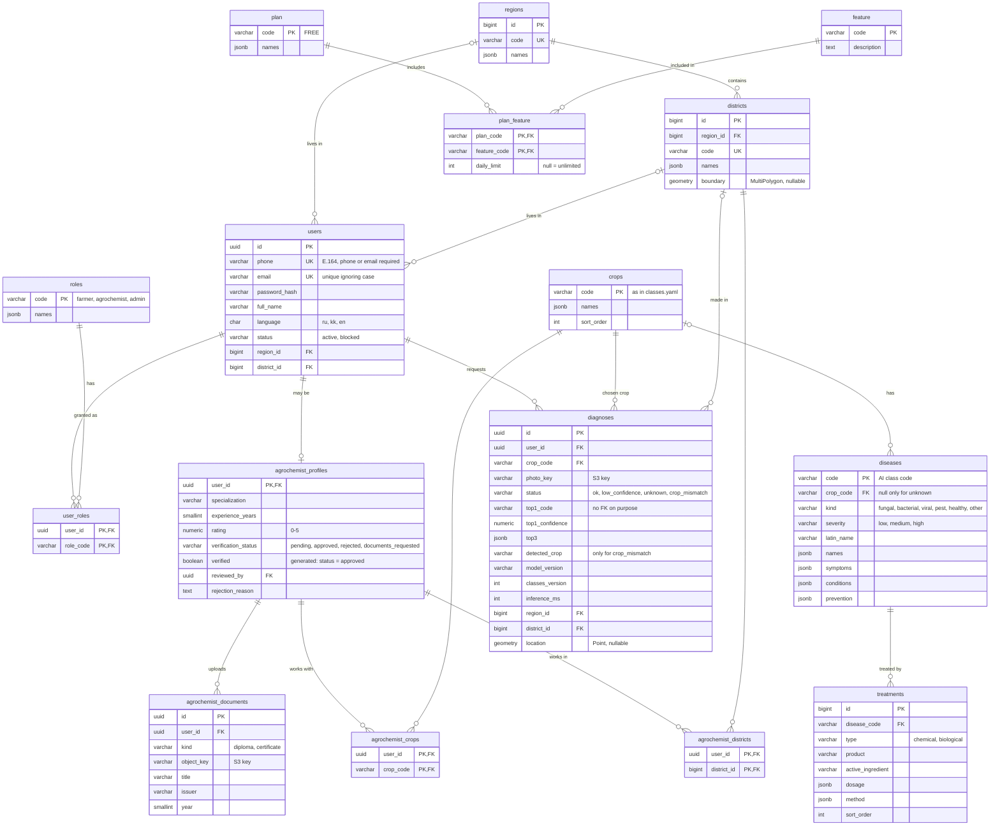
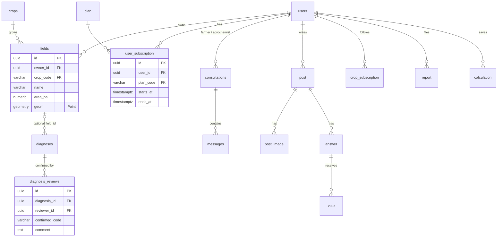

# Database ER diagram

PostgreSQL 16 + PostGIS. The schema is owned by Flyway migrations in [`services/backend/src/main/resources/db/migration`](../../services/backend/src/main/resources/db/migration); this page describes migrations `V1`–`V5`.

Conventions:

- Translated texts are `jsonb` objects `{"ru": …, "kk": …, "en": …}`; for names all three languages are required by a check constraint.
- Users, diagnoses and documents use `uuid` keys (they appear in URLs and the API); reference data uses readable codes (`tomato`, `tomato__late_blight`, `farmer`, `FREE`).
- Coordinates are `geometry(…, 4326)` with GiST indexes.
- Photos and documents are stored in S3 storage (SeaweedFS); tables keep only object keys.

## Current schema

Seed data in migrations: roles `farmer`, `agrochemist`, `admin`; plan `FREE` with features `diagnosis`, `community`, `consultations`, `disease_map`, `weather`, `calculator`, `shops`, `catalog` — all unlimited. Regions, districts, crops, diseases and treatments are filled by separate data migrations.

### Notes

- **`diagnoses.top1_code` has no foreign key.** A new model may return a class that is not in the catalog yet; the diagnosis is saved and shown as "description coming soon" (rule 5 in [`docs/ai/classes.md`](../ai/classes.md)).
- **`agrochemist_profiles.verified`** is computed from `verification_status`, so the two never disagree. Farmers see only verified agrochemists.
- **Feature access.** Code checks whether the user's plan includes a feature instead of checking roles, so paid plans can be added later as data. Today everyone is on `FREE` and nothing is limited; the per-minute diagnosis rate limit lives in Redis, not in the database.

## Planned tables

Added by later migrations when the corresponding features are built; existing migrations are never edited.

Also planned: `consultations`, `messages`, `agro_shops`, community tables (`post`, `post_image`, `answer`, `vote`, `crop_subscription`, `report`, plus `users.reputation`), `calculation`, `disease_alert`.
